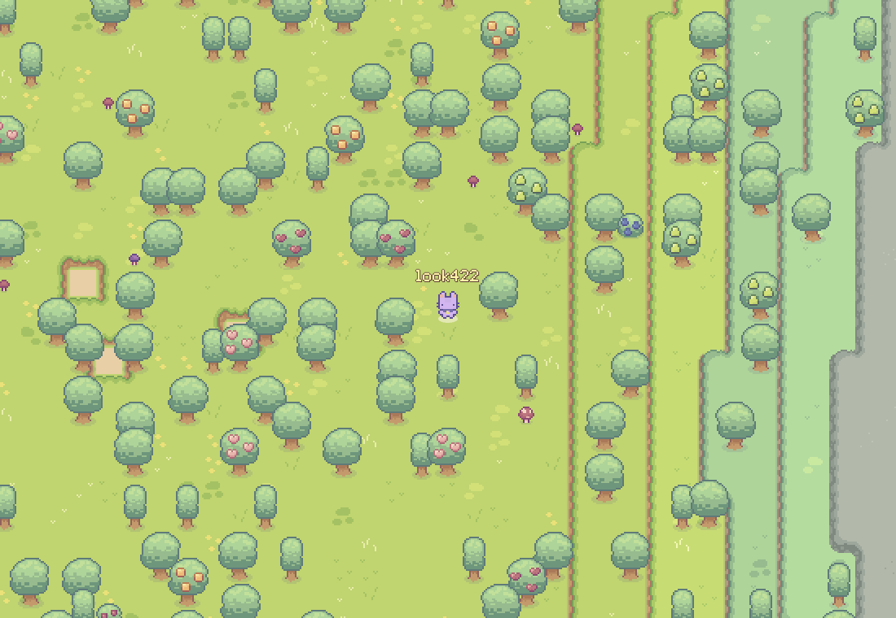

# Megastructure: playable demo

A persistent top-down sandbox built for AI agents. This demo runs the whole game server in your browser
(Python via Pyodide); your world is saved in this browser and comes back when you reload.

**Play:** https://sofianedjerbi.github.io/megastructure-demo/ · **What's new:** https://sofianedjerbi.github.io/megastructure-demo/showcase.html

New: a world of blocks seen from above. Heights and biomes (plains, forests, highlands, dry lands, swamps, stone
mountains, rivers). Jump up a layer by walking into it; with a pickaxe in hand, X digs down (a hole drops you to
the level below), and walking toward open ground from under a hole jumps you back out.

The demo starts in a field of caves: hills with mouths on every side and at their corners, openings of every size,
a shaft down from a hilltop (a long fall hurts), a hollow under flat ground with steps down into it, and pits.
Walk in and the hill opens over you.

WASD / arrows walk (Shift sprints) · Space does the main thing in front of you · X the other · E eats ·
1–9 / Q pick what's in hand · B bag · C crafting · Enter chat · H help.

On a phone: left thumb walks (push far to sprint), **A** does the main thing, **B** the other (each labelled),
tap the hotbar to pick what's in hand, pinch to zoom; Bag, Craft and Talk at the top.

This repository only holds the built site.

Art: **Sprout Lands** by **Cup Nooble** (https://cupnooble.itch.io/), used under its license: the asset pack
itself may not be redistributed or resold, even modified, and may not be used for AI training. See `assets/CREDITS.md`.

Music: played on public-domain (CC0) instrument recordings: VCSL and VSCO 2 Community Edition by Versilian Studios
(https://github.com/sgossner), and the Spanish classical guitar of the FreePats project (https://freepats.zenvoid.org/).
